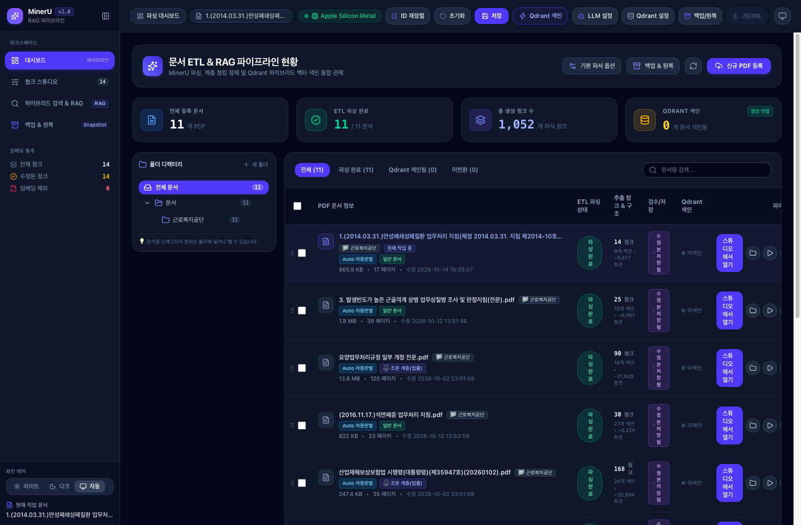
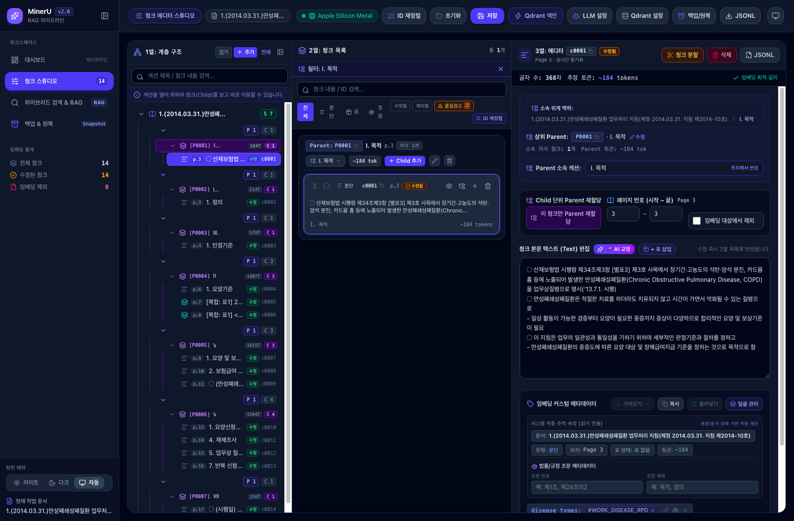
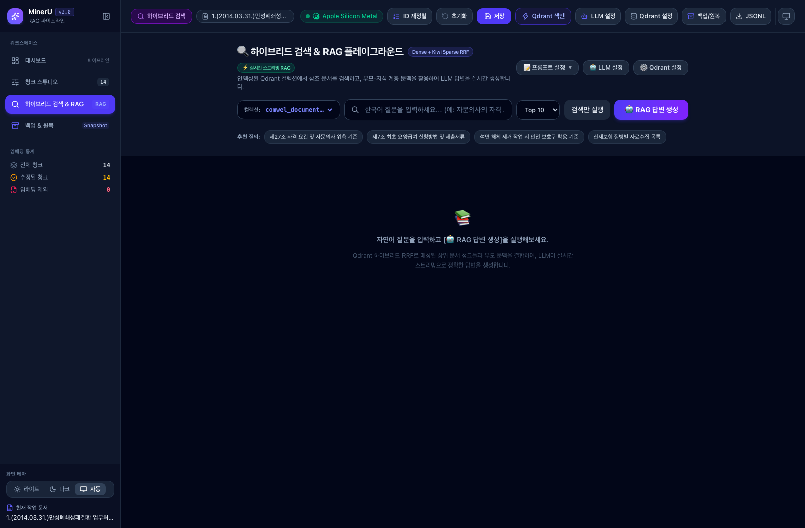
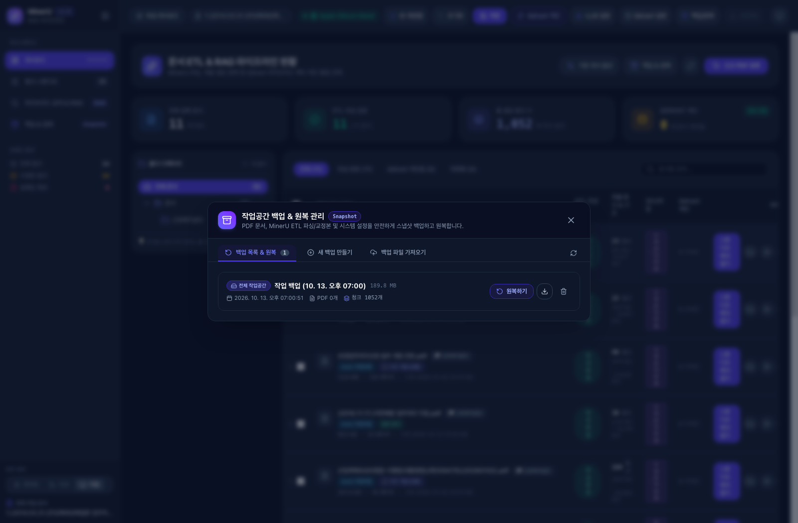
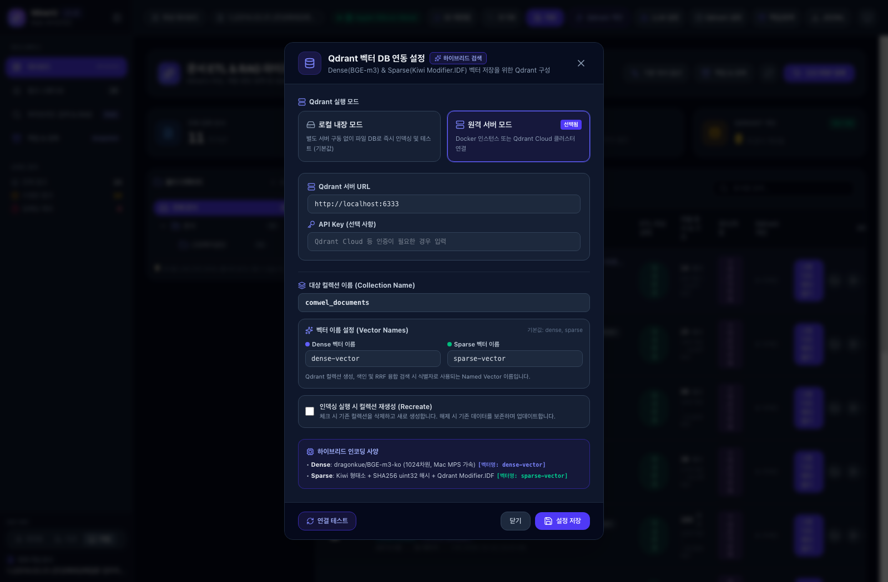
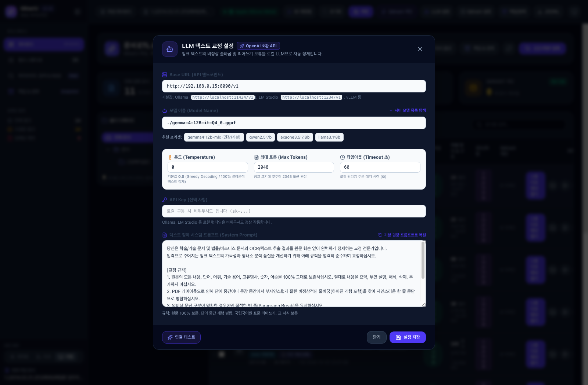

# MinerU RAG ETL Studio 사용자 매뉴얼 & 가이드

**MinerU RAG ETL Studio**는 OpenDataLab의 **MinerU** 엔진을 기반으로, PDF 문서를 파싱하여 **부모-자식(Parent-Child) 계층 청킹** 및 **무손실 표(Atomic Table)** 추출, **로컬 LLM 텍스트 교정**, **Qdrant 하이브리드 벡터 색인**까지 원스톱으로 지원하는 종합 RAG ETL 플랫폼입니다.

---

## 📑 목차
1. [시스템 시작 및 접속 방법](#1-시스템-시작-및-접속-방법)
2. [전체 화면 구성 및 주요 기능](#2-전체-화면-구성-및-주요-기능)
   - [2.1 통합 대시보드 (Dashboard Overview)](#21-통합-대시보드-dashboard-overview)
   - [2.2 청크 스튜디오 (Chunk Studio)](#22-청크-스튜디오-chunk-studio)
   - [2.3 하이브리드 검색 & RAG 플레이그라운드](#23-하이브리드-검색--rag-플레이그라운드)
   - [2.4 스냅샷 백업 & 원복(복원) 관리](#24-스냅샷-백업--원복복원-관리)
   - [2.5 Qdrant 벡터 DB 연동 및 색인](#25-qdrant-벡터-db-연동-및-색인)
   - [2.6 로컬 LLM 텍스트 자동 교정](#26-로컬-llm-텍스트-자동-교정)
3. [표준 RAG JSONL 포맷 및 외부 연동](#3-표준-rag-jsonl-포맷-및-외부-연동)

---

## 1. 시스템 시작 및 접속 방법

### 1.1 서비스 구동 및 정지

터미널에서 프로젝트 루트 디렉터리로 이동 후 다음 스크립트를 실행합니다.

```bash
# 백그라운드 구동 (FastAPI 백엔드 + 프론트엔드 서버)
./run-bg.sh

# 백그라운드 서비스 정지
./stop-bg.sh
```

### 1.2 접속 주소
- **웹 스튜디오 (UI)**: [http://localhost:5174](http://localhost:5174) 또는 [http://localhost:8001](http://localhost:8001)
- **FastAPI 백엔드 API**: [http://localhost:8001](http://localhost:8001)
- **Swagger API 문서**: [http://localhost:8001/docs](http://localhost:8001/docs)

> [!TIP]
> Apple Silicon(Mac M-시리즈) 환경에서는 백엔드에서 **Metal/MLX 하드웨어 가속**을 자동으로 감지하여 고속으로 임베딩 및 파싱을 수행합니다.

---

## 2. 전체 화면 구성 및 주요 기능

### 2.1 통합 대시보드 (Dashboard Overview)

문서 저장소 내 모든 PDF의 ETL 파싱, 청크 산출물, 검수/저장 여부, Qdrant 벡터 색인 상태를 한눈에 파악할 수 있는 관제 화면입니다.



#### 주요 기능
1. **거시 지표 관제 카드**:
   - **전체 등록 문서 수**: 관리 중인 PDF 총 수량
   - **ETL 파싱 완료율**: MinerU 파싱 파이프라인 완료 현황
   - **총 생성 청크 수**: 정밀 검색용 자식(Child) 청크 총계
   - **Qdrant 색인 현황**: 벡터 DB에 색인 완료된 문서 수 및 연결 상태
2. **폴더 디렉터리 트리 (좌측 패널)**:
   - 디렉터리별(예: `근로복지공단` 등) 폴더 분류 및 신규 폴더 생성
   - 문서를 드래그 앤 드롭하여 원하는 폴더로 실시간 이동 및 정리
3. **문서 목록 테이블**:
   - 문서별 크기, 페이지 수, 파싱 상태 뱃지 (`파싱 완료`, `미변환` 등)
   - **추출 청크 & 구조**: 청크 수, 상위 부모 섹션 수, 추정 토큰 수 표시
   - **검수/저장 상태**: 원본 대비 사용자 수정 사항(`수정본 저장됨`) 여부 표시
   - **작업 액션**: 원클릭으로 청크 스튜디오 진입, 재파싱 실행, 문서 삭제/초기화

---

### 2.2 청크 스튜디오 (Chunk Studio)

MinerU가 추출한 헤딩 계층과 본문, 표 데이터를 **부모-자식(Parent-Child) 계층 구조**로 시각화하고 실시간으로 검수·편집할 수 있는 3단 분할 전문 작업공간입니다.



#### 3단 작업 영역 안내
1. **1열: 문서 계층 구조 (Hierarchy Tree)**
   - 문서의 목차, 장, 절, 조문 트리를 시각적으로 탐색
   - 특정 섹션을 클릭하면 2열에서 해당 섹션에 속한 청크만 즉시 필터링
   - 섹션 추가, 검색, 부모 위계 재배치 지원
2. **2열: 청크 목록 (Chunk Explorer)**
   - 상위 부모(Parent) 블록과 하위 자식(Child) 청크 카드 목록 표시
   - 단락(문단), 표(Table), 조문별 필터링
   - 청크별 토큰 수, 페이지 번호, 품질 경고 뱃지 표시
   - **ID 재정렬**: 청크 순서가 바뀌었을 때 ID를 표준 규격(`c0001`, `c0002`...)으로 순차 재부여
3. **3열: 청크 상세 에디터 (Chunk Editor)**
   - **소속 위계 맥락**: 문서 전체 경로 및 직속 상위 부모 섹션 문맥 확인
   - **실시간 본문 텍스트 편집**: 마크다운 문법 지원, 즉각적인 수정 반영
   - **임베딩 대상에서 제외 토글**: 검색 노이즈가 되는 목차나 단순 서식 문단을 임베딩 대상에서 제외(`is_ignored`)
   - **청크 분할 / 삭제 / 단일 JSONL 확인**: 문단이 너무 긴 경우 2개 이상으로 즉시 분할
   - **법률/규정 조문 메타데이터 및 커스텀 태그**: 조문 번호(예: `제34조제3항`), 법령 태그, 질병 분류 코드 등 사용자 정의 메타데이터 주입

---

### 2.3 하이브리드 검색 & RAG 플레이그라운드

구축된 Qdrant 벡터 인덱스를 대상으로 **Dense(의미 기반) + Sparse(키워드 기반)** 하이브리드 검색 품질을 실시간으로 테스트하고, LLM에 주입될 부모 컨텍스트를 시뮬레이션할 수 있습니다.



#### 주요 기능
1. **자연어 질의 테스트**:
   - 질문(Query)을 입력하고 `Top-K` 및 유사도 임계치 설정 후 검색 실행
2. **부모-자식 컨텍스트 확장 (Small-to-Big Retrieval)**:
   - 검색은 정밀한 **자식(Child) 청크**로 매칭하고, LLM 답변 생성 시에는 거시적인 **부모(Parent) 섹션 전문**을 컨텍스트로 제공하는 구조 확인
3. **검색 점수 & 원본 페이지 메타데이터**:
   - 유사도 스코어, 일치 단락, 해당 페이지 번호, 표 원형 여부 확인

---

### 2.4 스냅샷 백업 & 원복(복원) 관리

문서 원본, MinerU 파싱 결과, 사용자 검수 및 교정 데이터(`rag_chunks_edited.json`), 시스템 설정을 단일 ZIP 파일로 안전하게 스냅샷 백업하고 복원합니다.



#### 주요 기능
1. **원클릭 스냅샷 생성**:
   - 전체 작업공간 백업 또는 개별 문서 백업 생성
2. **무손실 안전 백업(Safety Backup) 자동 생성**:
   - 이전 시점으로 복원(원복)을 실행할 때, 현재 상태가 유실되지 않도록 직전 상태의 안전 백업이 자동 생성됩니다.
3. **백업 다운로드 & 업로드**:
   - 로컬 백업 ZIP 파일을 다운로드하여 오프라인 보관
   - 외부에서 작업한 백업 ZIP 파일을 업로드하여 스튜디오에 즉시 복원

---

### 2.5 Qdrant 벡터 DB 연동 및 색인

고성능 벡터 검색 엔진인 **Qdrant**와의 연동 정보를 설정하고, 문서 청크 데이터를 대량 임베딩·색인합니다.



#### 주요 설정 항목
- **Qdrant 호스트 & 포트**: 로컬(`localhost:6333`) 또는 원격 Qdrant 클러스터 엔드포인트
- **컬렉션 이름**: 기본 컬렉션명 지정 (예: `mineru_rag_chunks`)
- **임베딩 모델 규격**: 벡터 차원(Dimension), 거리 측정 방식(Cosine 등)
- **연결 테스트(Test Connection)**: 실시간 핑 및 컬렉션 존재 여부 진단

---

### 2.6 로컬 LLM 텍스트 자동 교정

OCR 또는 PDF 파싱 과정에서 발생하는 **비정상적인 줄바꿈(단어 중간 개행)** 및 **한국어 맞춤법/띄어쓰기 규정**을 로컬 LLM을 통해 완전 자동으로 정제합니다.



#### 주요 기능 및 설정
- **OpenAI 호환 엔드포인트 지원**: LM Studio, Ollama, vLLM, mlx-lm 등 로컬 추론 서버와 연동 (예: `http://localhost:1234/v1`)
- **권장 모델**: `gemma-2-9b-it`, `gemma4:12b-mlx`, `solar-pro` 등 (Temperature: 0.0 고정 권장)
- **Diff 비교 검수(Before vs After)**:
  - 교정 전 텍스트와 교정 후 텍스트를 나란히 비교하여 원클릭으로 반영 여부 결정 가능

---

## 3. 표준 RAG JSONL 포맷 및 외부 연동

청크 스튜디오 상단의 **[JSONL]** 버튼 또는 API(`/api/etl/export/jsonl`)를 통해 LangChain, LlamaIndex, Chroma, Milvus, Qdrant 등에 즉시 적재 가능한 표준 규격의 JSONL 파일을 내보낼 수 있습니다.

### JSONL 레코드 구조 예시
```json
{
  "id": "c0001",
  "doc_id": "만성폐쇄성폐질환 업무처리 지침.pdf",
  "page_start": 3,
  "page_end": 3,
  "chunk_type": "paragraph",
  "text": "산재보험법 시행령 제34조제3항 [별표3] 제3호 사목에서 장기간·고농도의 석탄·암석 분진 등에 노출되어 발생한 만성폐쇄성폐질환(COPD)을 업무상질병으로 명시함.",
  "parent_chunk_id": "P0001",
  "parent_section_id": "sec_01",
  "parent_title": "I. 목적",
  "parent_hierarchy": ["만성폐쇄성폐질환 지침", "I. 목적"],
  "parent_text": "I. 목적\n산재보험법 시행령 제34조제3항 [별표3] 제3호 사목에서...",
  "is_table": false,
  "table_html": null,
  "metadata": {
    "article_no": "제34조제3항",
    "disease_types": ["WORK_DISEASE_RPD"]
  }
}
```

---

## 💡 요약 및 작업 팁
- **작업 저장 필수**: 청크 스튜디오에서 수정한 내용은 상단의 **[저장]** 버튼을 눌러야 `rag_chunks_edited.json`으로 영구 보존됩니다.
- **표 원형 보존**: 표 데이터는 임의로 텍스트 분할하지 않고 `<table>` 태그와 이미지 bbox 메타데이터를 유지하므로, 표 검색 시 최상의 무손실 품질을 유지합니다.
- **백업 생활화**: 대규모 수정이나 재파싱을 진행하기 전에는 **백업 & 원복** 메뉴에서 스냅샷 백업을 생성해두는 것을 권장합니다.
